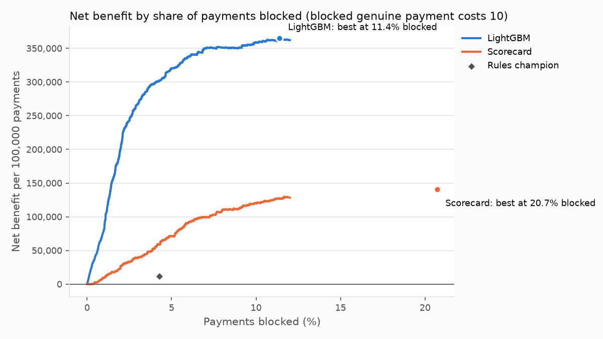

# Decisions in money

Generated by `scripts/choose_cutoff.py`, on the validation month. Amounts are in the dataset's currency (not stated by Vesta; most likely US dollars).

**Assumption:** blocking a genuine payment costs **10** (handling, an annoyed or lost customer, lost sales). A blocked fraud saves its amount. Net benefit = fraud money blocked - cost x genuine payments blocked, per 100,000 payments.

## Strategies compared

| strategy                                    | decline_rate   | fraud_caught   | fraud_value_caught   |   genuine_blocked_per_100k |   net_benefit_per_100k |   vs_rules_per_100k |
|:--------------------------------------------|:---------------|:---------------|:---------------------|---------------------------:|-----------------------:|--------------------:|
| Rules champion                              | 4.3%           | 22.9%          | 8.0%                 |                      3,479 |                 11,594 |                  +0 |
| Scorecard, best cut-off                     | 20.7%          | 64.2%          | 56.2%                |                     18,478 |                140,654 |            +129,061 |
| LightGBM, best cut-off                      | 11.4%          | 75.7%          | 78.1%                |                      8,765 |                364,726 |            +353,133 |
| LightGBM, expected-cost rule (amount-aware) | 5.9%           | 56.5%          | 73.2%                |                      3,901 |                384,844 |            +373,250 |

- **Best cut-off**: one score threshold for every payment, chosen where net benefit peaks.
- **Expected-cost rule**: block when P(fraud) x amount > (1 - P(fraud)) x cost. It uses the amount, so a risky large payment is blocked while an equally risky tiny one goes through.

## How sensitive is this to the cost assumption?

|   cost_per_blocked_genuine |   rules_net_benefit_per_100k | lightgbm_best_cutoff_blocks   |   lightgbm_best_cutoff_net_benefit_per_100k | expected_cost_rule_blocks   |   expected_cost_rule_net_benefit_per_100k |
|---------------------------:|-----------------------------:|:------------------------------|--------------------------------------------:|:----------------------------|------------------------------------------:|
|                          2 |                       39,429 | 35.0%                         |                                     488,267 | 17.6%                       |                                   495,905 |
|                          5 |                       28,990 | 20.7%                         |                                     423,920 | 9.4%                        |                                   442,235 |
|                         10 |                       11,594 | 11.4%                         |                                     364,726 | 5.9%                        |                                   384,844 |
|                         25 |                      -40,597 | 6.2%                          |                                     282,157 | 3.3%                        |                                   323,611 |
|                         50 |                     -127,581 | 3.6%                          |                                     221,499 | 2.2%                        |                                   279,421 |

## Champion / challenger simulation

8,640 randomly chosen payments (10%) go to LightGBM at its best cut-off, the other 76,663 to the rules. Difference in net benefit per 100,000 payments (LightGBM minus rules): **418,543**, 95% interval 292,130 to 562,417 (bootstrap, 1,000 resamples).

In a live trial, blocked payments rarely get confirmed as fraud or genuine, so the measurement must allow for that; here every label is known.

## Calibration: do LightGBM's probabilities mean what they say?

The expected-cost rule needs this. Payments split into 10 equal groups by predicted risk:

|   group | predicted   | actual   |   payments |
|--------:|:------------|:---------|-----------:|
|       1 | 0.07%       | 0.02%    |       8531 |
|       2 | 0.13%       | 0.13%    |       8530 |
|       3 | 0.19%       | 0.22%    |       8530 |
|       4 | 0.27%       | 0.42%    |       8530 |
|       5 | 0.36%       | 0.36%    |       8531 |
|       6 | 0.49%       | 0.66%    |       8530 |
|       7 | 0.69%       | 1.55%    |       8530 |
|       8 | 1.06%       | 2.13%    |       8530 |
|       9 | 1.98%       | 3.83%    |       8530 |
|      10 | 20.63%      | 25.39%   |       8531 |

## Saved for Step 7

`reports/cutoffs.json`: LightGBM threshold 0.0259, scorecard threshold 0.0396. Step 7 applies these unchanged to the untouched test month.
